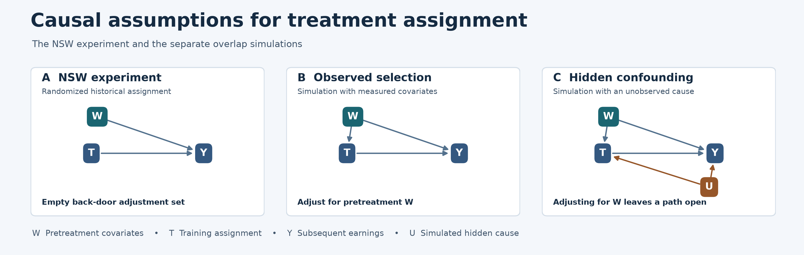

# Causal diagram and identification

[Vector figure](../results/figures/nsw_causal_dag.svg)

| Panel | Edges | Identification |
|---|---|---|
| A. NSW randomized assignment | W → Y and T → Y | The model factorizes as p(W)p(T)p(Y ∣ W,T). Randomization makes T independent of W. No back-door path from T to Y is open, so the empty adjustment set identifies the effect under the stated assumptions. Baseline outcome adjustment can help precision. |
| B. Simulated observed selection | W → T, W → Y, T → Y | Conditioning on pretreatment W blocks the back-door path T ← W → Y. Identification also requires overlap, consistency, and no interference. |
| C. Simulated hidden confounding | The edges in B plus U → T and U → Y | Conditioning on W leaves T ← U → Y open. The simulation compares observed-only and oracle adjustment using known simulated outcomes and propensities. The oracle sees U. |

**Notation.** W is the pretreatment covariate vector. For NSW, it contains age, education, recorded race indicators, marital and diploma indicators, and RE74/RE75 earnings. In the overlap simulation, W represents the simulated observed covariate and group. T is historical or simulated treatment assignment, Y is the subsequent outcome, and U is simulated hidden confounding. The proposed allocation D is a hypothetical decision based on pretreatment information and a cohort capacity. Historical NSW records supply no realized outcomes under that proposed policy.

The main empirical analysis relies on random assignment, consistency, overlap and no interference. Exclude post-treatment earnings, employment, or other potential mediators from the adjustment set. Treat the separate discrete Bayesian-network fixture in `verify_inference.py` as a numerical check of variable elimination and clique-tree inference. Its conditional probability tables are constructed for verification.

See [assumptions.md](assumptions.md) for the assumptions register and [model_card.md](model_card.md) for the estimands and fairness criterion.
